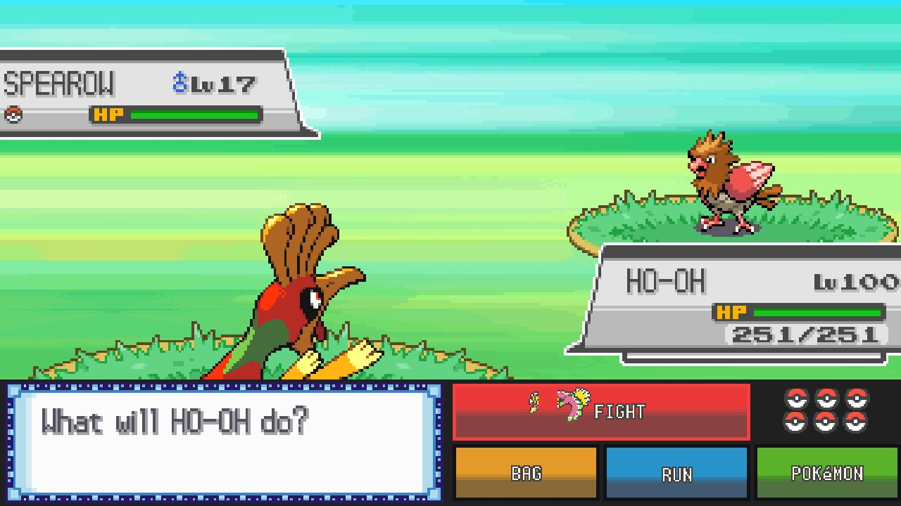

# Pokémon DS games on the Nintendo Switch

**Your favourite DS Pokémon games on a modded Switch: one screen, widescreen,
720p, 60 fps.** No more squinting at two tiny stacked DS screens.

| Game | Status | Download |
|---|---|---|
| **Pokémon Black 2 and White 2** | ✅ out now | [pokemon-black2-white2-wide-switch.zip](../../releases/tag/bw2-switch-v1) |
| **Pokémon SoulSilver and HeartGold** | ✅ out now | [pokemon-soulsilver-heartgold-wide-switch.zip](../../releases/tag/soulsilver-heartgold-v1) |
| **Pokémon Black and White** | ✅ out now | [pokemon-black-white-wide-switch.zip](../../releases/tag/black-white-switch-v1) |
| **All six games in one program** (choose the game when it starts) | 🆕 next release | `pokemon-ds-wide-switch.zip` |
| **All six games in one zip** (one program per game) | ✅ out now | [pokemon-ds-wide-all-switch.zip](../../releases/tag/all-games-v1) |
| **Pokémon Omega Ruby** | 🛠️ in the works (its own project) | |

Every download is free of the games themselves: you bring your own ROM, and
the program reads what it needs from it when the game starts.

## What is it?

A Switch homebrew app that runs the game on the melonDS emulator core, plus a
layer that knows what the game is doing (which screen, which menu, which
battle) and rearranges it into one proper widescreen picture. It is **not a
native port** (those are the dream, see [What's next](#whats-next)); it's the
DS game, presented the way it should look on a Switch.

## Why not just play it in melonDS?

| | melonDS | this |
|---|---|---|
| Screens | two 256×192 DS screens, stacked or side by side | one 16:9 picture, the touch screen's buttons tucked beside the action |
| 3D world | 4:3 at DS resolution | 16:9 at 720p, drawn by the Switch's graphics chip, skies and scenery carried to the edges |
| Frame rate | the game's own 30 fps 3D | 60 fps, with in-between frames |

## Installing (any of the games)

1. Download the game's zip (table above), or the one with all six games, and
   unzip it to the root of the SD card. It makes a folder for each game in
   `/switch/`; a game whose ROM you don't put in its folder just isn't used.
2. Copy your own ROM into the game's folder, as the only `.nds` file there.
3. **Hold R while starting any game** to open the Homebrew Menu, then pick the
   game (started from the album there is not enough memory). **QUIT** in the
   pause menu (+ and − together) saves and goes back to the Homebrew Menu.

Each game keeps its save in its own folder (named below). To carry on from an
emulator or a flash cart, copy your save in under that name.

**Recommended: start each game from the HOME Menu.** With
[sphaira](https://github.com/ITotalJustice/sphaira) (a Homebrew Menu you can
use instead of the usual one) you can install a forwarder for each game: an
icon on the Switch's HOME Menu that starts it directly, with no holding R. In
sphaira's Homebrew list, select the game (for example `pokemon-black2-wide`) and
choose to install a forwarder. Do it once per game; keep the game's folder
where it is, as the forwarder starts the `.nro` in it. Each game then has its
own entry, so sys-clk (below) can have its own settings for it.

### All the games in one program

`pokemon-ds-wide-switch.zip` is one program for all six games, with a grid to
choose from when it starts. Each game is shown with the icon from its ROM, or
with a picture of your own: put it in `/switch/pokemon-ds-wide/icons/` named
after the game's code (`IRBO` Black, `IRAO` White, `IREO` Black 2, `IRDO`
White 2, `IPKE` HeartGold, `IPGE` SoulSilver), e.g. `icons/IREO.jpg` (JPEG or
PNG, square). A game in a one-game folder shows that program's HOME Menu icon.

1. Unzip it to the root of the SD card. It makes `/switch/pokemon-ds-wide/`.
2. Copy your ROMs into that folder (any names; a `roms` folder inside it works
   too). Each game keeps its save there under its own name (`black2.sav`,
   `soulsilver.sav` and so on).
3. Hold R while starting any game, pick **Pokemon DS Widescreen**, then the
   game. **CHANGE GAME** in the pause menu saves and goes back to the list.

Already using the one-game folders? Leave them as they are and put no ROM in
`/switch/pokemon-ds-wide/`: the list then shows the games in your other
`/switch/` folders, each played with the save already in its folder. With
only one ROM in the folder there is no list: that game starts straight away.

---

## Pokémon Black 2 and White 2

| | |
|---|---|
|  |  |
|  |  |

- **Download:** [`pokemon-black2-white2-wide-switch.zip`](../../releases/tag/bw2-switch-v1),
  folders `/switch/pokemon-black2-wide/` and `/switch/pokemon-white2-wide/`.
- **ROMs:** any English copy (US or Europe), trimmed or not, including the
  "NDSi Enhanced" one. Other languages put the game's code elsewhere: the
  program says so instead of starting.
- **Saves:** `black2.sav` and `white2.sav` (`tools/bw2/convert_save.py` turns
  `.dsv` and Action Replay saves into the raw 512 KB save).
- **What you get:** battles (single, double, triple, rotation) with the HP boxes
  at the edges of the wide view and the battle buttons beside them; menus, the
  bag and the save screen laid out for one screen; and more of the map loaded
  around you, so the wide view never runs out of land.

## Pokémon SoulSilver and HeartGold

| | |
|---|---|
|  |  |

- **Download:** [`pokemon-soulsilver-heartgold-wide-switch.zip`](../../releases/tag/soulsilver-heartgold-v1),
  folders `/switch/pokemon-soulsilver-wide/` and `/switch/pokemon-heartgold-wide/`.
- **ROMs:** the English US versions. Other versions start, but without the
  one-screen layouts.
- **Saves:** `soulsilver.sav` and `heartgold.sav` (the same format, so either
  game reads the other's).
- **What you get:** Johto and Kanto in widescreen, with your partner Pokémon
  walking behind you; battles with their buttons beside the action; menus laid
  out for one screen. Where this project started: the
  original ssrecomp was SoulSilver on the PC.

## Pokémon Black and White

| | |
|---|---|
|  |  |
|  |  |

- **Download:** [`pokemon-black-white-wide-switch.zip`](../../releases/tag/black-white-switch-v1),
  folders `/switch/pokemon-black-wide/` and `/switch/pokemon-white-wide/`.
- **ROMs:** any English copy (US or Europe), trimmed or not.
- **Saves:** `black.sav` and `white.sav` (the same format, so either game reads
  the other's; `tools/bw2/convert_save.py` turns `.dsv` and Action Replay saves
  into the raw 512 KB save).
- **What you get:** Unova's first adventure with the same treatment as Black 2:
  battles (single, double, triple, rotation) with the HP boxes at the edges of
  the wide view and the battle buttons beside them; its own layouts for the
  start menu, the X menu, the save screen, the Badge Case and the Pokédex; and
  the C-Gear's question at the start answered for you.

---

## Recommended settings

**sys-clk** (recommended for full speed), handheld. With a forwarder (above),
start the game, open sys-clk's overlay and set these for that game's own
profile: they then apply whenever you play it, and only then. Without one, set
them for the game you start the Homebrew Menu from, or as the global profile.

| | |
|---|---|
| CPU | 1785 MHz |
| GPU | 460 MHz (the highest of the console's own handheld speeds; no need to go higher) |
| Memory | 1600 MHz |

Without sys-clk the games run at the console's normal speeds and drop frames
in busy places.

**Pause menu** (+ and − together). Black 2 and White 2 already start with
what is recommended, and every game always uses the one wide screen:

| Setting | Recommended | What it does |
|---|---|---|
| 60 FPS | ON | in-between frames: the games draw their 3D at 30 fps |
| BATTLE BUTTONS | PANEL | Black 2, White 2, Black and White: the game's own FIGHT, BAG, RUN and POKÉMON panel beside the battle (Black and White also have STRIP: large buttons in the message box) |
| WORLD DETAIL | 720 | lines the wide world is drawn with (540 if you want headroom) |
| LOWER DETAIL WHEN BUSY | ON | fewer lines for a moment instead of slowing down |
| WORLD ON GPU | ON | the world drawn by the graphics chip |

The games run on melonDS's FAST JIT. If a start ever fails with it, the next
one falls back by itself (hold L while starting for the interpreter).

## Under the hood

The widescreen world is drawn by the Switch's graphics chip (deko3D), so Black
2 runs at (or a whisker under) 60 fps at 720p in towns and battles, measured on
a Switch OLED in handheld mode. The full list of changes is in
[CHANGELOG.md](CHANGELOG.md).

## Known limits

- Black, White, Black 2 and White 2: English (US/Europe) versions only. SoulSilver
  and HeartGold: US versions only.
- SoulSilver and HeartGold: at map borders (Route 29 and New Bark Town, Celadon
  City and Route 16), parts of the neighbouring map pop in and out at the sides
  of the wide view. Loading more of the map, as Black 2 and White 2 do, should
  fix it.
- Switch only for now. Bug reports: attach `game.log` from the game's folder,
  and a save state from the pause menu if you can.

## What's next

- **Pokémon Omega Ruby**: in the works, as its own project.
- **Native Switch ports**: the dream, hopefully for all of them. Optimistic,
  but we're aiming for it.

## Building it yourself

On Linux or Windows with WSL2 (Ubuntu 24.04), with git, CMake, Ninja, Python 3
and devkitPro's Switch toolchain (`sudo dkp-pacman -S switch-dev switch-sdl2`,
or Docker, which then uses devkitPro's `devkitpro/devkita64` image):

    tools/switch/build_game.sh bw

makes the Black 2 and White 2 zip and the Black and White one in `build-sd/`
(no ROM needed), and

    tools/switch/build_game.sh hgss your-soulsilver-us.nds

the SoulSilver and HeartGold one (the SoulSilver ROM only gives the addresses
in its tables; none of its code goes in). The full instructions, and the other
builds, are in the
[original project's README](docs/original-ssrecomp-README.md#nintendo-switch-experimental).

## Support

Tips are welcome but never expected:
[buy me a coffee](https://buymeacoffee.com/mamesj) or
[PayPal](https://paypal.me/mamesj).

## Credits and licence

A fork of [ClickingMaster/ssrecomp](https://github.com/ClickingMaster/ssrecomp)
(Pokémon SoulSilver recompiled for single-screen devices), which gave this its
single-screen and widescreen view; [its README](docs/original-ssrecomp-README.md)
covers that project. Function names come from the
[pokebw2](https://github.com/fuddlesworth/pokebw2) and
[aletheia](https://github.com/Project-Holon/aletheia) decompilations (only their
symbol files); SoulSilver's and HeartGold's addresses come from ssrecomp's own
SoulSilver layout. The DS is emulated by [melonDS](https://melonds.kuribo64.net).

GPL-3.0-or-later (see `LICENSE`), as required by melonDS. Not affiliated with
or endorsed by Nintendo, Game Freak, The Pokémon Company or the melonDS
project; Pokémon is a trademark of its owners.

---

Built with the help of [Claude](https://claude.ai), Anthropic's AI.
