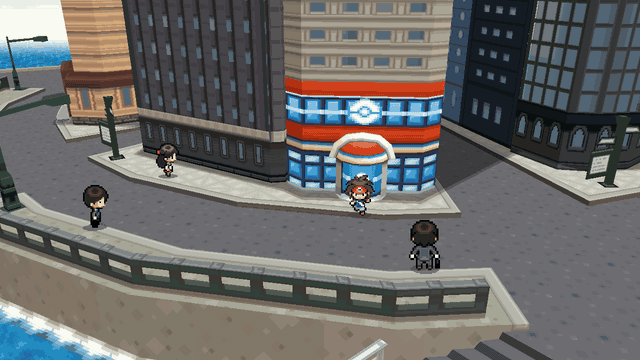
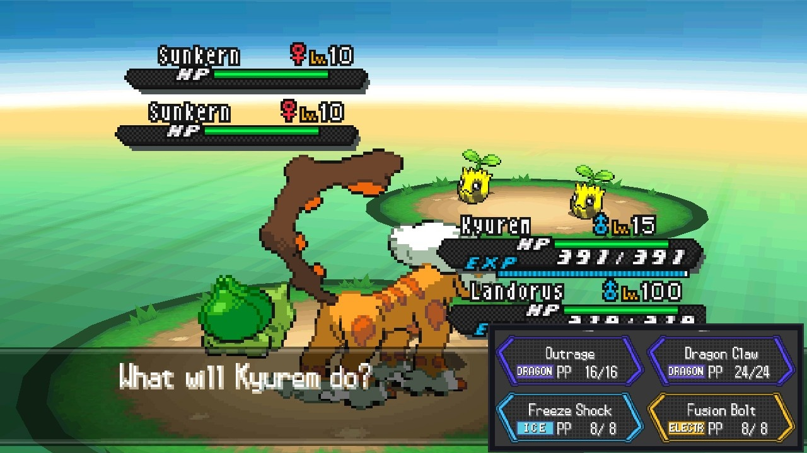
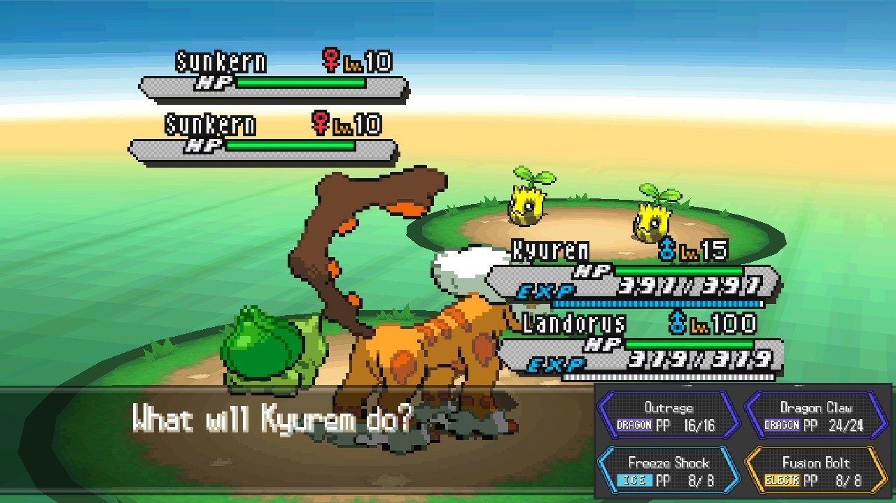

# Pokémon Black 2 and White 2 on the Nintendo Switch

**Pokémon Black 2 and White 2 on your modded Switch: one screen, widescreen,
720p, 60 fps.** No more squinting at two tiny stacked DS screens.

## What is it?

A Switch homebrew app that runs the game on the melonDS emulator core, plus a
layer that knows what the game is doing (which screen, which menu, which
battle) and rearranges it into one proper widescreen picture. It is **not a
native port** (that's coming soon); it's the DS game, presented the way it
should look on a Switch.

## Why not just play it in melonDS?

| | melonDS | this |
|---|---|---|
| Screens | two 256×192 DS screens, stacked or side by side | one 16:9 picture, the touch screen's buttons tucked beside the action |
| 3D world | 4:3 at DS resolution | 16:9 at 720p, drawn by the Switch's graphics chip, skies and scenery carried to the edges |
| Frame rate | the game's own 30 fps 3D | 60 fps, with in-between frames |

| | |
|---|---|
|  |  |
|  |  |

*Pictures from the PC test build, which draws the Switch's picture (only the
edges of polygons can differ by a pixel), at 720 lines.*

## Install

Download `ssrecomp-black2-white2-switch.zip` from the
[latest release](../../releases/latest). Nothing of the games is in it: the
program reads what it needs from your own ROM when it starts.

1. Unzip it to the root of the SD card (it makes `/switch/ssrecomp-black2/` and
   `/switch/ssrecomp-white2/`).
2. Copy your ROM into its folder, as the only `.nds` file there. Any English
   (US or Europe) copy works, trimmed or not, including the "NDSi Enhanced" one.
   Other languages put the game's code elsewhere: the program says so instead
   of starting.
3. **Hold R while starting any game** and choose Pokemon Black 2 or Pokemon
   White 2 in the Homebrew Menu (started from the album there is not enough
   memory). **QUIT** in the pause menu saves and goes back to the Homebrew Menu.

To use a save from an emulator or a flash cart, copy it into the folder as
`black2.sav` or `white2.sav` (`tools/bw2/convert_save.py` turns `.dsv` and
Action Replay saves into the raw 512 KB save).

## Recommended settings

**sys-clk** (optional; in its overlay, for the game you start the Homebrew
Menu from, or as the global profile), handheld:

| | |
|---|---|
| CPU | 1785 MHz |
| GPU | 460 MHz (the highest of the console's own handheld speeds; no need to go higher) |
| Memory | 1600 MHz |

With sys-clk setting the clocks, turn **CPU BOOST** off in the pause menu so
the two do not fight. Without sys-clk, leave CPU BOOST on: it sets the same
processor and memory speeds itself (the graphics chip stays at the system's
speed).

**Pause menu** (+ and − together). The first start already uses what is
recommended, except CPU BOOST with sys-clk:

| Setting | Recommended | What it does |
|---|---|---|
| 60 FPS | ON | in-between frames: the game draws its 3D at 30 fps |
| CPU BOOST | ON, or OFF with sys-clk | processor 1785 MHz, memory 1600 MHz |
| BATTLE BUTTONS | CORNER or PANEL | where a battle's touch-screen buttons go |
| WORLD DETAIL | 720 | lines the wide world is drawn with (540 if you want headroom) |
| LOWER DETAIL WHEN BUSY | ON | fewer lines for a moment instead of slowing down |
| WORLD ON GPU | ON | the world drawn by the graphics chip |
| EMULATION | FAST JIT | from the next start; FAST JIT, JIT or INTERPRETER |

If a start ever fails with FAST JIT, the next one falls back by itself (hold L
while starting for the interpreter). QUIT in the pause menu saves first.

## Under the hood

The widescreen world is drawn by the Switch's graphics chip (deko3D), so Black
2 runs at (or a whisker under) 60 fps at 720p in towns and battles, measured on
a Switch OLED in handheld mode.
Battles, menus and the save screen have their own one-screen layouts, and
Black 2 loads more of its map around you so the wide view never runs out of
land. The full list is in [CHANGELOG.md](CHANGELOG.md).

## Known limits

- White 2 doesn't load the extra map around you yet (with it, its overworld
  didn't come back after a trainer battle), so the land can stop at the edges
  of the wide view in places.
- English (US/Europe) versions only: the program says so for other languages.
- Switch only for now. Bug reports: attach `game.log` from the game's folder,
  and a save state from the pause menu if you can.

## Building it yourself

On Linux or Windows with WSL2 (Ubuntu 24.04), with git, CMake, Ninja, Python 3
and devkitPro's Switch toolchain (`sudo dkp-pacman -S switch-dev switch-sdl2`,
or Docker, which then uses devkitPro's `devkitpro/devkita64` image):

    tools/switch/build_game.sh bw

makes the release's zip in `build-sd/` (no ROM needed). The full instructions,
and builds for SoulSilver and Black, are in the
[original project's README](docs/original-ssrecomp-README.md#nintendo-switch-experimental).

## Support

Tips are welcome but never expected:
[buy me a coffee](https://buymeacoffee.com/mamesj) or
[PayPal](https://paypal.me/mamesj).

## Credits and licence

A fork of [ClickingMaster/ssrecomp](https://github.com/ClickingMaster/ssrecomp)
(Pokémon SoulSilver recompiled for single-screen devices), which gave this its
single-screen and widescreen view; [its README](docs/original-ssrecomp-README.md)
covers that project. Function names come from the
[pokebw2](https://github.com/fuddlesworth/pokebw2) and
[aletheia](https://github.com/Project-Holon/aletheia) decompilations (only their
symbol files), and the DS is emulated by [melonDS](https://melonds.kuribo64.net).

GPL-3.0-or-later (see `LICENSE`), as required by melonDS. Not affiliated with
or endorsed by Nintendo, Game Freak, The Pokémon Company or the melonDS
project; Pokémon is a trademark of its owners.

---

Built with the help of [Claude](https://claude.ai), Anthropic's AI.
