# Pokémon DS Widescreen

**Your favourite DS Pokémon games on a PC (Windows and Linux) or a modded
Nintendo Switch: one screen, widescreen, 60 fps, up to 4K on a PC and 720p on
the Switch.** No more squinting at two tiny stacked DS screens.

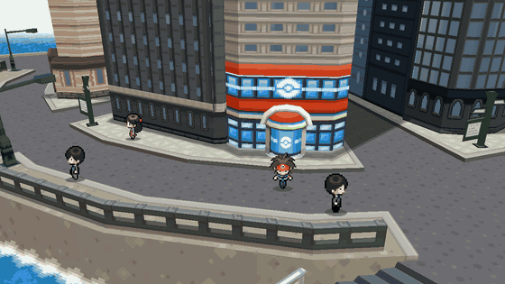

## Downloads

| | PC (Windows and Linux) | Nintendo Switch |
|---|---|---|
| **Download: all seven games in one program** | [Windows and Linux](../../releases/tag/pc-v1) | [pokemon-ds-wide-all-switch.zip](../../releases/tag/all-games-v2) |
| Pokémon Black 2 and White 2 | ✅ | ✅ |
| Pokémon Black and White | ✅ | ✅ |
| Pokémon SoulSilver and HeartGold | ✅ | ✅ |
| Pokémon Platinum | ✅ | ✅ |
| Pokémon Omega Ruby | 🛠️ in the works (its own project) | 🛠️ in the works |

One program per platform: start it and pick the game from the list. The
downloads are free of the games themselves: you bring your own ROMs, and the
program reads what it needs from them when the game starts.

## Use your own save

Carry on from your own save: from another emulator, a flash cart or your real
cartridge. Copy it in under the game's name, in this folder:

| Where you play | Folder |
|---|---|
| PC (Windows, Linux, Steam Deck) | the `saves` folder beside the program |
| Nintendo Switch | `/switch/pokemon-ds-wide/` on the SD card |

| Game | Save name |
|---|---|
| Black 2 / White 2 | `black2.sav` / `white2.sav` |
| Black / White | `black.sav` / `white.sav` |
| SoulSilver / HeartGold | `soulsilver.sav` / `heartgold.sav` |
| Platinum | `platinum.sav` |

- **Which files work:** a plain `.sav`, as melonDS, DeSmuME (Export Backup
  Memory), flash carts (TWiLight Menu++, R4 and the like) and cartridge dump
  tools (Checkpoint, JKSM, GodMode9) make it. A DraStic or DeSmuME `.dsv`, or an
  Action Replay save (`.duc`), first goes through
  [`tools/bw2/convert_save.py`](tools/bw2/convert_save.py).
- **Check it worked:** the game list shows SAVE FOUND under the game (NEW GAME: not found).
- **Back up first:** a save copied in replaces the one there under that name.

## What is it?

A program for your PC or your Switch (as homebrew) that runs the game on the
melonDS emulator core (built in: there is nothing else to install), plus a
layer that knows what the game is doing (which screen, which menu, which
battle) and rearranges it into one proper widescreen picture. It is **not a
native port** (those are the dream, see [What's next](#whats-next)); it's the
DS game, presented the way it should look on a modern screen.

## Why not just play it in melonDS?

| | melonDS | this |
|---|---|---|
| Screens | two 256×192 DS screens, stacked or side by side | one 16:9 picture, the touch screen's buttons tucked beside the action |
| 3D world | 4:3 at DS resolution | 16:9, skies and scenery carried to the edges: up to 4K on a PC (your graphics card), 720p on the Switch (its graphics chip) |
| Frame rate | the game's own 30 fps 3D | 60 fps, with in-between frames |

---

## On a PC (Windows and Linux)

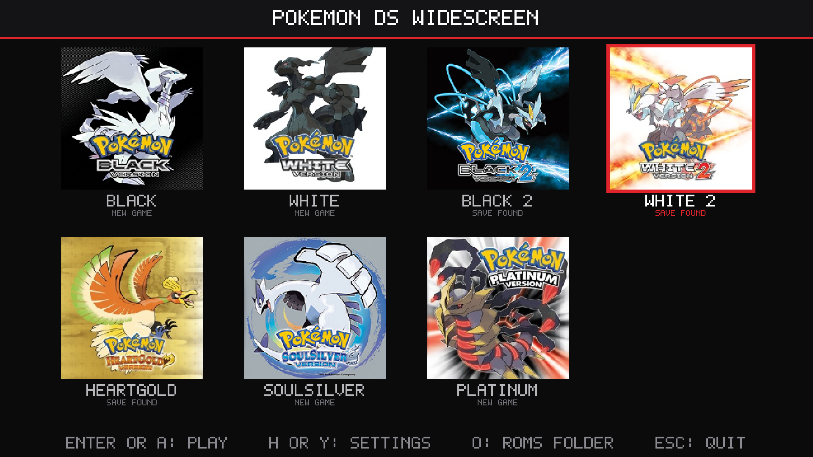

1. **Download** [`pokemon-ds-wide-pc-windows-x86_64.zip`](../../releases/tag/pc-v1)
   (Windows) or [`pokemon-ds-wide-pc-linux-x86_64.tar.gz`](../../releases/tag/pc-v1) (Linux).
2. **Unpack it** anywhere (not inside Program Files) and put your ROMs in its
   `roms` folder (any names).
3. **Start** `Pokemon DS Launcher.exe` (Linux: `pokemon-ds-wide`) and pick a game.
   Windows may warn about an unknown publisher the first time: choose
   "More info", then "Run anyway".

It starts in borderless fullscreen at 1080p with 60 fps; **F11** switches to a
window. In the game list, arrow keys or a controller choose, **Enter** or **A**
plays, **H** (or a controller's **Y**) opens the settings and **O** opens the
`roms` folder. While playing, **Esc** (or a controller's Guide button, or Start
and Select together) opens the pause menu; **QUIT** there goes back to the list.

**Controls:** any controller (Xbox, PlayStation, Switch Pro and others) plays
as a DS; hold its right trigger to fast forward. On the keyboard: arrow keys,
X/Z for A/B, S/A for X/Y, Q/W for L/R, Enter for START, Backspace for SELECT,
the mouse for the touch screen and Left Shift to fast forward. The `README.txt`
inside has the full list.

**Saves** go in the `saves` folder, one per game (`black2.sav`, `soulsilver.sav`,
`platinum.sav`, ...). To carry on from another emulator, put its `.sav` there
under that name. **Pictures**: the list shows each game's box art; for your own,
put a JPEG or PNG in an `icons` folder beside the program, named after the game's
code (`IREO.jpg` for Black 2, see the `README.txt`).

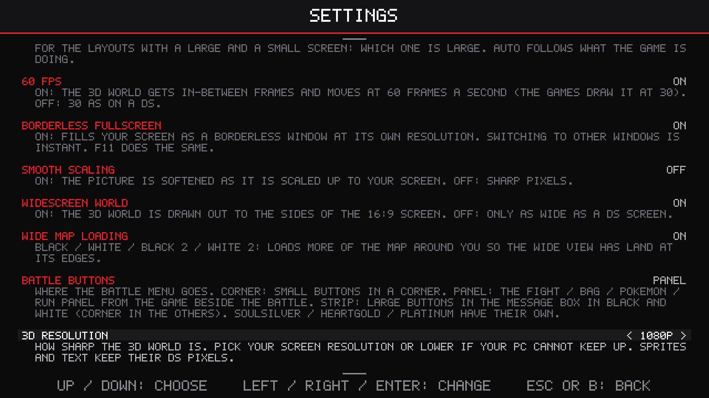

**Settings:** the settings page in the game list sets everything in the pause
menu before you play, each option explained. The ones that matter most on a PC:

| Setting | Starts at | What it does |
|---|---|---|
| 3D RESOLUTION | 1080P | how sharp the 3D world is: 720P, 1080P, 1440P (2K) or 2160P (4K) |
| LOWER RES WHEN BUSY | ON | a lower resolution for a moment instead of slowing down |
| FAST FORWARD LOW RES | OFF | ON: 360P while fast forwarding, for more FPS on a slower PC |
| WORLD ON GPU | ON | the world drawn by your graphics card; turn it off if it looks wrong |
| BORDERLESS FULLSCREEN | ON | fills your screen; F11 does the same |
| SCREEN LAYOUT | MERGED | the one widescreen picture, or the two DS screens laid out as on other emulators |

**Desktop shortcuts:** DESKTOP SHORTCUTS on the settings page puts a shortcut for each
game on your desktop (on Linux also in your apps menu, and so in the Steam Deck's "Add a
Non-Steam Game" list), with its box art; each starts its game straight away.

**What it needs:** Windows 10 or 11 (64-bit), or 64-bit Linux from late 2023 on
(Ubuntu 24.04, Fedora 39, SteamOS 3.5 or newer); nothing else to install. For WORLD
ON GPU, a graphics card with OpenGL 4.3, which nearly any from 2012 on has with
up-to-date drivers; without it, the processor draws the world (that wants a
much faster processor).

**Steam Deck:** in Desktop Mode, unpack the Linux download and put your ROMs in
its `roms` folder; in Steam, **Games > Add a Non-Steam Game to My Library**,
browse to `pokemon-ds-wide` (file type: All Files); then start it from your
library in Gaming Mode with a gamepad controller layout. Set 3D RESOLUTION to
720P for the Deck's 1280x800 screen.

**How fast a PC?** Not measured on a range of PCs yet, so these are estimates.
The Switch runs all seven games at 60 fps, and one core of any PC from the last
eight years or so is several times as fast as one of the Switch's. What grows
with your screen is the 3D resolution, drawn by the graphics card:

- *Minimum:* a 4-core processor (Intel Core i5 6th generation or Ryzen 1000 on),
  graphics built into the processor (Intel HD 520 or Radeon Vega 8 class) at
  720p to 1080p, 4 GB of memory.
- *Recommended:* a recent 6-core processor and a graphics card such as a GTX
  1060 or RX 580 for 1440p; 4K wants an RTX 2070 or better.

Tell us how yours runs, with its `game.log`.

---

## On the Nintendo Switch

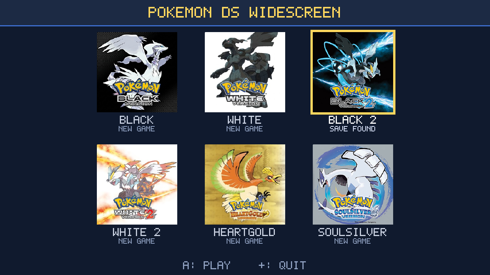

**All seven games in one program** (`pokemon-ds-wide-all-switch.zip`):

1. Unzip it to the root of the SD card. It makes `/switch/pokemon-ds-wide/`
   with an empty `roms` folder inside.
2. Copy your ROMs into `/switch/pokemon-ds-wide/roms/` (any names).
3. Hold R while starting any game, pick **Pokemon DS Widescreen**, then the
   game (started from the album there is not enough memory).

In the list the D-pad or a stick moves between games, **A** plays, **Y** opens
the settings (the pause menu's options, each explained) and **+** goes back to
the Homebrew Menu. It opens on the game you played last. While playing, **+
and − together** open the pause menu; **QUIT** there saves and comes back to
the list (also when started from its HOME Menu icon). With only one game found
there is no list: it starts straight away. **Touch screen:** tap it in handheld
mode; docked, the right stick moves a cursor and **ZL** touches. Pressing the
right stick in shows the other screen.

**Coming from the older one-game downloads?** Their folders keep working: the
list also shows the games in them (`/switch/pokemon-black2-wide/` and so on) and
plays each with the save already there. Those downloads are no longer updated,
so the all-in-one is the one to use.

**Saves:** each game keeps its save under its own name (`black2.sav`,
`white2.sav`, `black.sav`, `white.sav`, `soulsilver.sav`, `heartgold.sav`,
`platinum.sav`): in `/switch/pokemon-ds-wide/` for a ROM in its `roms` folder,
or in an older one-game download's folder for a ROM there. To carry on from an
emulator or a flash cart, copy your save in under that name.

**Pictures:** each game shows its box art. For your own, put a square JPEG
or PNG in `/switch/pokemon-ds-wide/icons/` named after the game's code: `IRBO`
Black, `IRAO` White, `IREO` Black 2, `IRDO` White 2, `IPKE` HeartGold, `IPGE`
SoulSilver, `CPUE` Platinum (e.g. `icons/IREO.jpg`).

**Recommended: start each game from the HOME Menu.** In the all-in-one's
settings (**Y** in the list), **HOME MENU ICONS** puts an icon for each game in
the list on the Switch's HOME Menu, with its box art, which starts that game
straight away with no holding R. It is made on your console (no PC or keys
file). Like any forwarder, the icons need sigpatches to start. Keep
`/switch/pokemon-ds-wide/` where it is, as the icons start the program in it;
choose HOME MENU ICONS again after adding games. Each game then has its own
entry, so sys-clk (below) can have its own settings for it. To remove one:
Options on its icon, Data Management, Delete Software.

**sys-clk** (recommended for full speed), handheld. With a forwarder, start the
game, open sys-clk's overlay and set these for that game's own profile: they
then apply whenever you play it, and only then. Without one, set them for the
game you start the Homebrew Menu from, or as the global profile.

| | |
|---|---|
| CPU | 1785 MHz (1581 is enough for most places) |
| GPU | 460 MHz (the highest of the console's own handheld speeds; no need to go higher) |
| Memory | 1600 MHz |

Without sys-clk the games run at the console's normal speeds and drop frames
in busy places.

**Settings** (the settings page in the game list, or the pause menu):

| Setting | Recommended | What it does |
|---|---|---|
| 60 FPS | ON | in-between frames: the games draw their 3D at 30 fps |
| BATTLE BUTTONS | PANEL | Black 2, White 2, Black and White: the game's own FIGHT, BAG, RUN and POKÉMON panel beside the battle (Black and White also have STRIP: large buttons in the message box) |
| WORLD DETAIL | 720 | lines the wide world is drawn with (540 if you want headroom) |
| LOWER DETAIL WHEN BUSY | ON | fewer lines for a moment instead of slowing down |

The world is always drawn by the Switch's graphics chip, and each frame is
shown at an even time, a frame after it is made (smoother in busy towns and
battles). The games run on melonDS's FAST JIT. If a start ever fails with it,
the next one falls back by itself (hold L while starting for the interpreter).

---

## The games

### Pokémon Black 2 and White 2

| | |
|---|---|
| 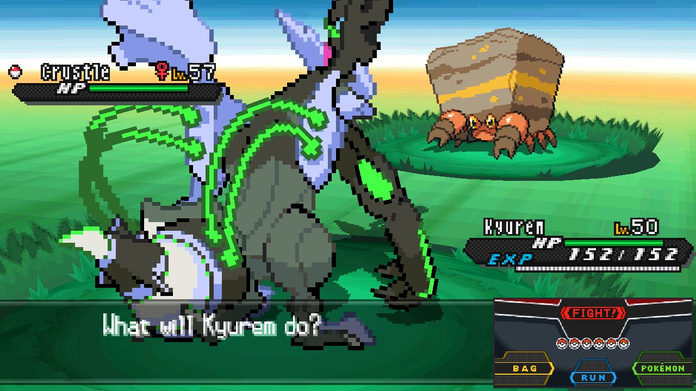 | 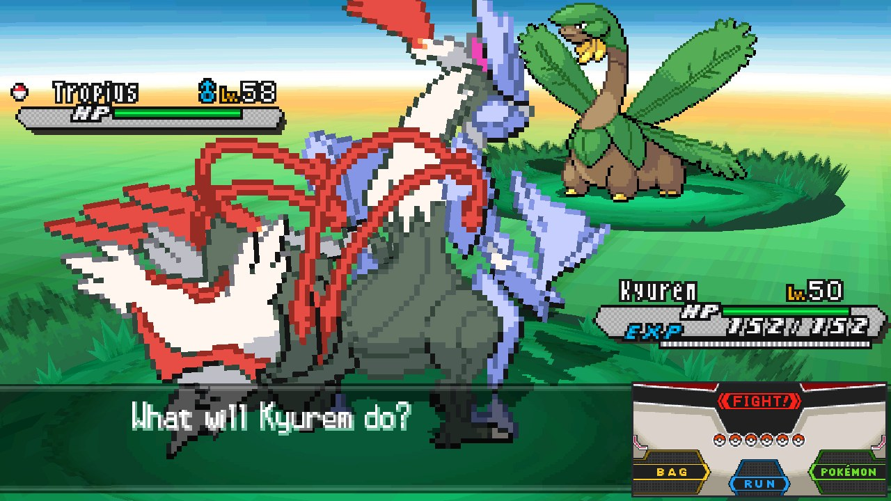 |
| 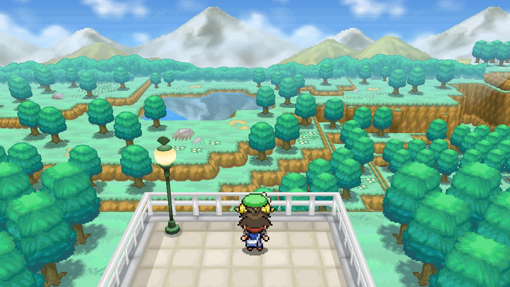 | 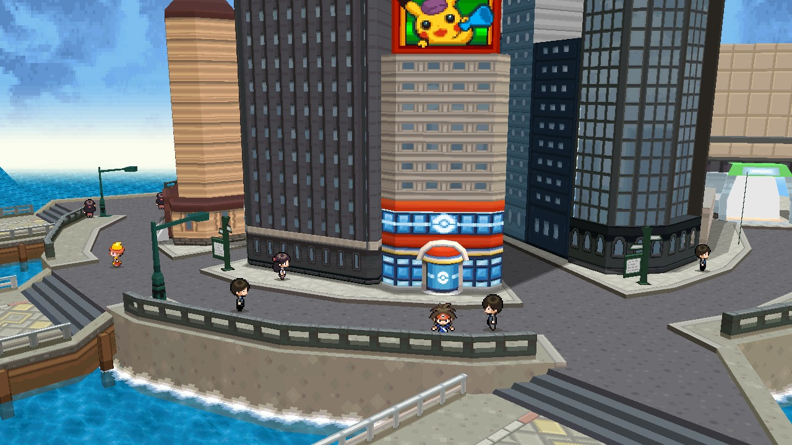 |

- **ROMs:** any English copy (US or Europe), trimmed or not, including the
  "NDSi Enhanced" one. Other languages put the game's code elsewhere: the
  program says so instead of starting.
- **Saves:** `black2.sav` and `white2.sav` (`tools/bw2/convert_save.py` turns
  `.dsv` and Action Replay saves into the raw 512 KB save).
- **What you get:** battles (single, double, triple, rotation) with the HP boxes
  at the edges of the wide view and the battle buttons beside them; menus, the
  bag and the save screen laid out for one screen; and more of the map loaded
  around you, so the wide view never runs out of land.

### Pokémon SoulSilver and HeartGold

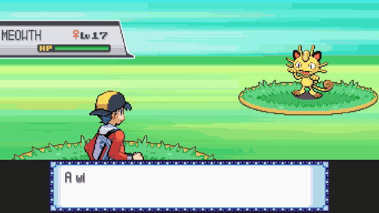

| | |
|---|---|
| 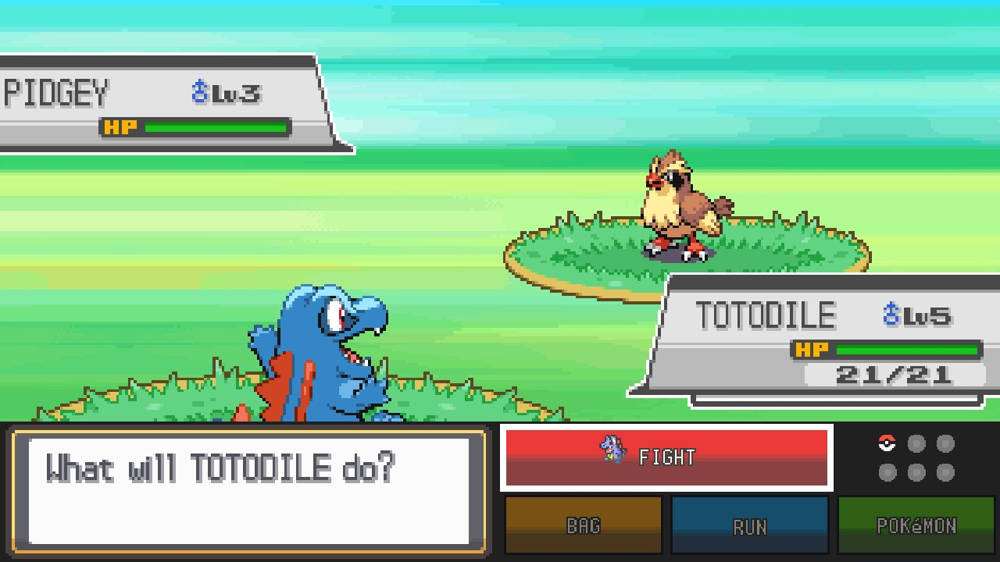 | 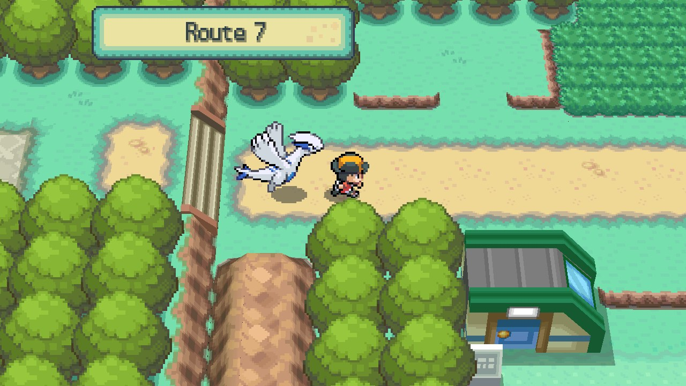 |

- **ROMs:** the English US versions. Other versions start, but without the
  one-screen layouts.
- **Saves:** `soulsilver.sav` and `heartgold.sav` (the same format, so either
  game reads the other's).
- **What you get:** Johto and Kanto in widescreen, with your partner Pokémon
  walking behind you; battles with their buttons beside the action; menus laid
  out for one screen. Where this project started: the original ssrecomp was
  SoulSilver on the PC.

### Pokémon Black and White

| | |
|---|---|
| 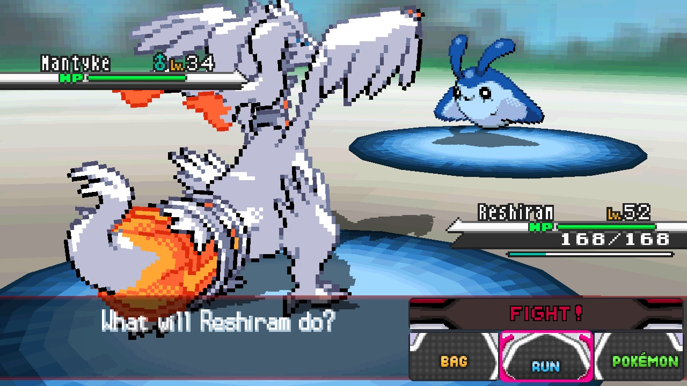 | 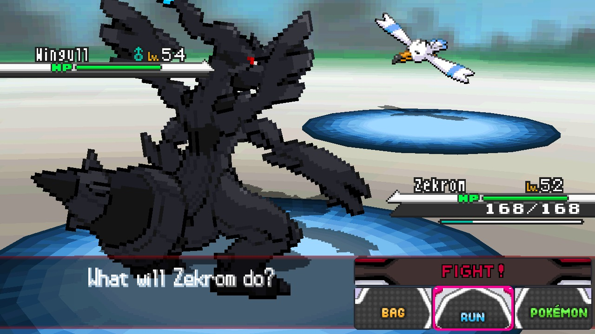 |
| 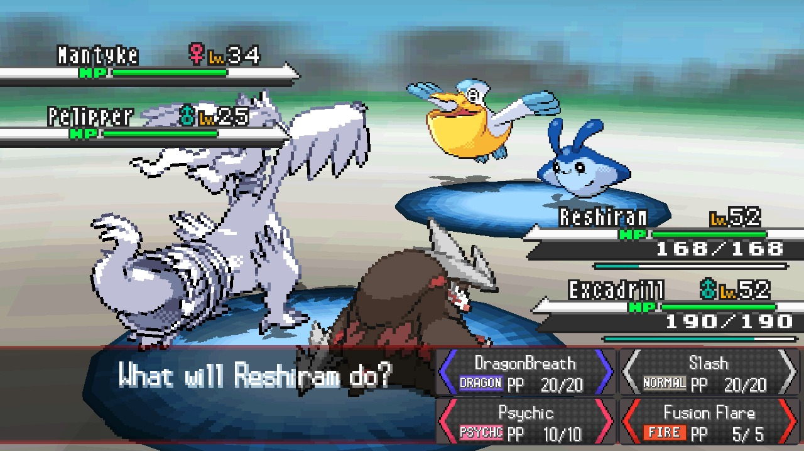 | 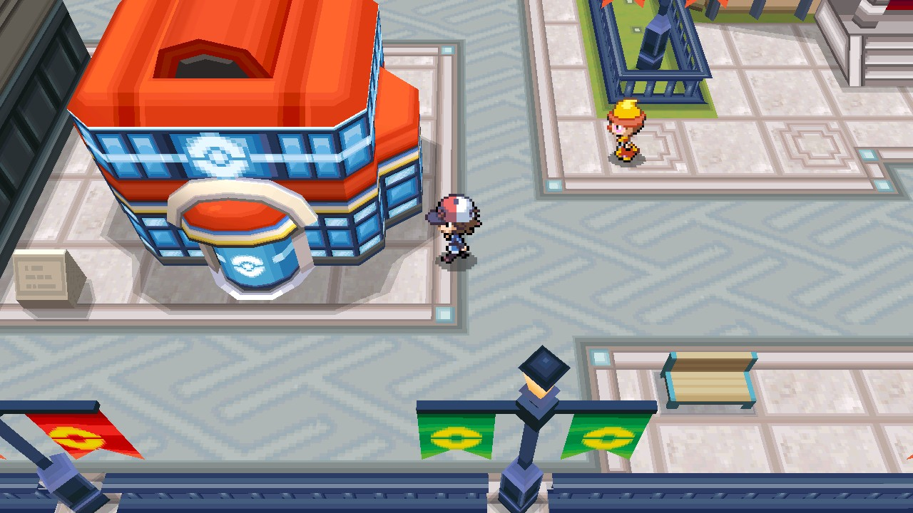 |

- **ROMs:** any English copy (US or Europe), trimmed or not.
- **Saves:** `black.sav` and `white.sav` (the same format, so either game reads
  the other's; `tools/bw2/convert_save.py` turns `.dsv` and Action Replay saves
  into the raw 512 KB save).
- **What you get:** Unova's first adventure with the same treatment as Black 2:
  battles (single, double, triple, rotation) with the HP boxes at the edges of
  the wide view and the battle buttons beside them; its own layouts for the
  start menu, the X menu, the save screen, the Badge Case and the Pokédex; and
  the C-Gear's question at the start answered for you.

### Pokémon Platinum

| | |
|---|---|
| 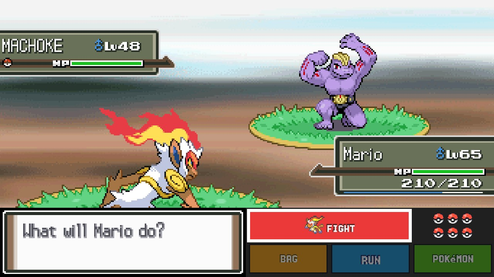 | 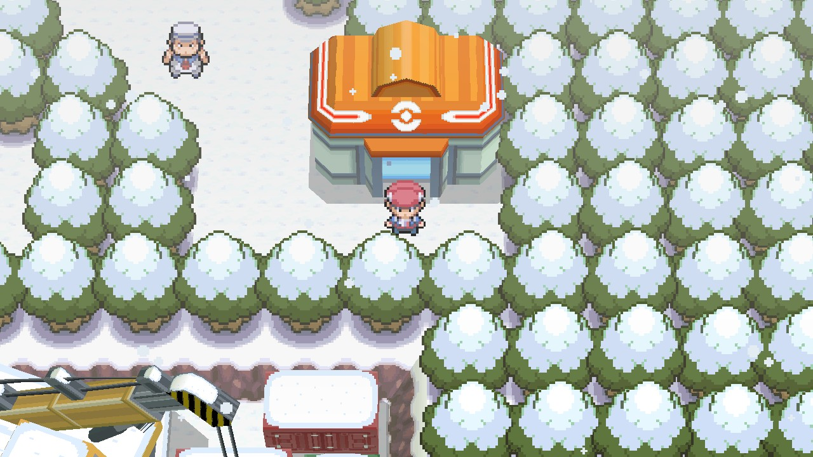 |

- **ROM:** the English US version (game code `CPUE`), trimmed or not.
- **Save:** `platinum.sav`.
- **What you get:** Sinnoh in widescreen, the snow and rain reaching the edges
  of the view; battles with their buttons and moves beside the action; the X
  menu at the right edge of the view, and the Bag, party, Pokédex, map and
  other menus laid out for one screen.

---

## Under the hood

The widescreen world is drawn by a graphics chip: your graphics card with
OpenGL on a PC, the Switch's own with deko3D. On the Switch, Black 2 runs at
(or a whisker under) 60 fps at 720p in towns and battles, measured on a Switch
OLED in handheld mode; a PC has room to spare, and draws the same picture up to
4K. The full list of changes is in [CHANGELOG.md](CHANGELOG.md).

## Known limits

- Black, White, Black 2 and White 2: English (US/Europe) versions only. SoulSilver,
  HeartGold and Platinum: US versions only.
- Platinum: the Pokétch (the watch on the touch screen) isn't shown during
  normal play; its apps are one press of the screen-swap button away.
- SoulSilver and HeartGold: at map borders (Route 29 and New Bark Town, Celadon
  City and Route 16), parts of the neighbouring map pop in and out at the sides
  of the wide view. Loading more of the map, as Black 2 and White 2 do, should
  fix it.
- PC: speeds on a range of PCs are estimates so far (see above).
- Found a bug? See [Reporting a bug](#reporting-a-bug).

## What's next

- **Pokémon Omega Ruby**: in the works, as its own project.
- **Native ports**: the dream, hopefully for all of them. Optimistic, but we're
  aiming for it.

## Reporting a bug

Open a **[bug report](https://github.com/mamesj/pokemon-ds-widescreen/issues/new?template=bug_report.yml)**
(you need to be signed in to GitHub). The form asks for the game, your ROM's
version and the **`game.log`** file, which says what the program did:

1. **Find it:** on a PC, `game.log` is in the folder you unpacked the download
   to. On the Switch it is in the game's folder on the SD card:
   `/switch/pokemon-ds-wide/` for the all-in-one, otherwise the game's own
   folder (e.g. `/switch/pokemon-black2-wide/`). It is written again each time
   the game starts, so copy it straight after the problem.
2. **Switch: get it onto a computer.** Put the SD card in a card reader; or,
   leaving it in the Switch, use Hekate's **Tools > USB Tools > SD Card** (or
   DBI's MTP mode) to see the card on the computer over USB; or an FTP app such
   as ftpd over Wi-Fi.
3. **Add it to the form:** drag the file into the `game.log` box.

A screenshot or short video helps too. Please never attach your ROM. A white or
black screen when a game starts usually means the ROM isn't one the program
plays: an English copy of Black, White, Black 2 or White 2 (US or Europe), or
the English US copy of SoulSilver, HeartGold or Platinum, unchanged (no
patches, translations, randomizers or trimming).

## Support

Tips are welcome but never expected:
[buy me a coffee](https://buymeacoffee.com/mamesj) or
[PayPal](https://paypal.me/mamesj).

## Credits and licence

A fork of [ClickingMaster/ssrecomp](https://github.com/ClickingMaster/ssrecomp)
(Pokémon SoulSilver recompiled for single-screen devices), which gave this its
single-screen and widescreen view; [its README](docs/original-ssrecomp-README.md)
covers that project. Function names come from the
[pokebw2](https://github.com/fuddlesworth/pokebw2) and
[aletheia](https://github.com/Project-Holon/aletheia) decompilations (only their
symbol files), Platinum's from a build of
[pret/pokeplatinum](https://github.com/pret/pokeplatinum); SoulSilver's and HeartGold's
addresses come from ssrecomp's own SoulSilver layout. The DS is emulated by [melonDS](https://melonds.kuribo64.net).
The Switch's HOME MENU ICONS are made the way [sphaira](https://github.com/ITotalJustice/sphaira)
makes its forwarders, with its homebrew loader (`tools/switch/forwarder`, GPL-3.0, based on
nx-hbloader).

GPL-3.0-or-later (see `LICENSE`), as required by melonDS. Not affiliated with
or endorsed by Nintendo, Game Freak, The Pokémon Company or the melonDS
project; Pokémon is a trademark of its owners. The box art in the PC game list belongs to
Nintendo, Creatures, GAME FREAK and The Pokémon Company and is shown only to tell the games
apart; it is not part of this repository's code. If you hold the rights and want it removed,
open an issue and it will be taken out.

---

Built with the help of [Claude](https://claude.ai), Anthropic's AI.
